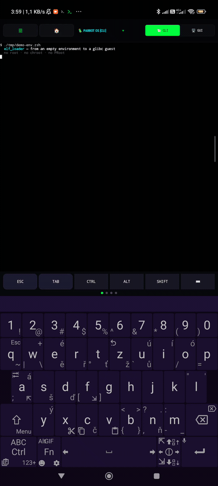

# elf_loader — run glibc Linux binaries on Android without root

**One loader, two userspaces.** elf_loader runs glibc binaries (Parrot / Debian
/ Ubuntu rootfs) directly on Android (bionic), in the same process — **without
proot, without chroot, without QEMU**. It maps the guest `libc.so.6` and its
dependencies into a private scope, applies relocations, and jumps to the guest
entry point.

Same kernel (Android), two userspaces: the bionic host and a glibc guest from a
rootfs.

```console
$ uname -srm
Linux 4.14.190-perf aarch64          # Android kernel, bionic host
$ cat /etc/os-release
cat: /etc/os-release: No such file or directory
$ lx cat /etc/os-release
PRETTY_NAME="Parrot Security 7.4 (echo)"
$ lx gcc hello.c -o hello && lx ./hello
hello from glibc, 42
```



**[▶ Watch the full 94-second demo](https://cdn.jsdelivr.net/gh/zombiegirlcz/elf_loader@master/docs/media/demo-env.mp4)**
— starts in an empty environment (`env -i`), sets up the paths, then runs
starship, python, uv, node and an interactive zsh. Reproduce it with
[`tools/demo-env.zsh`](tools/demo-env.zsh).

## Highlights

- **No root, no proot, no chroot** — plain non-root own-loading.
- **Works where proot struggles** — a seccomp compat filter emulates syscalls
  that Android's app profile (kernel 4.14) kills, so glibc's legacy fallbacks
  work.
- **Drop-in proot replacement** — `--proot-compat` takes proot's own command
  line, and the emulation is now at parity: full fake root (`-0`), full bind
  mounts (`-b`, including `ro`), `/proc` virtualization, and host-path
  isolation, so a guest never sees outside its rootfs. **Existing scripts need
  no changes — swap the `proot` binary for a symlink to the loader and they
  keep working.**
- **Real toolchains** — `gcc` (with `ld`/`as` via a guest `PATH`), `python3`,
  `uv`, `git`, `gh`, `fzf`, Node.js, `tmux`, and a full interactive zsh with a
  starship prompt.
- **Any rootfs, any app** — everything is driven by environment variables, no
  hard-coded paths.

## Quick start

```sh
export D=$HOME                          # app files dir (= HOME)
export ROOTFS=$D/nh/distro/parrot       # guest rootfs
export R=$ROOTFS
export L=$D/usr/bin/elf_loader          # the loader binary

# one eval gives you the whole `lx` environment (lx, lxwhich, help, ...)
eval "$($L init zsh)"                   # or: eval "$($L init bash)"

lx cat /etc/os-release                  # runs the guest cat
lx python3 -c 'import sys; print(sys.version)'
lx gcc hello.c -o hello && lx ./hello   # compile + run inside the guest
```

`init zsh|bash` follows the same shell-integration pattern as
`starship init zsh` / `zoxide init zsh`. It derives everything from
`$HOME`/`$ROOTFS`:

| variable | meaning | default |
|---|---|---|
| `D` | app files dir | `$HOME` |
| `LX_DISTRO` | distro name used for rootfs autodetect | `parrot` |
| `LX_GUEST_HOME` | home directory **inside** the rootfs | `/root` |
| `ROOTFS` | guest rootfs (autodetect) | `$D/nh/distro/$LX_DISTRO` |
| `R` | alias for `ROOTFS` | `$ROOTFS` |
| `L` | loader binary (autodetect, incl. `$PREFIX/bin`) | `$D/usr/bin/elf_loader` |
| `LX_LOG` | log directory | `$HOME/.cache/lx` |
| `LOCPATH` | guest locale dir (only if it exists) | `$ROOTFS/usr/lib/locale` |
| `LC_ALL` | locale | `C.UTF-8` |

Nothing is hard-coded to a particular distro. `ROOTFS` is autodetected from
`$D/nh/distro/$LX_DISTRO`, `$D/$LX_DISTRO`, `$D/.local/share/$LX_DISTRO`, then
the Termux proot-distro layouts `$PREFIX/var/lib/proot-distro/containers/$LX_DISTRO`
(proot-distro ≥ 4) and `…/installed-rootfs/$LX_DISTRO` (older).

```sh
ROOTFS=/other/rootfs zsh                 # explicit rootfs wins
LX_DISTRO=debian zsh                     # autodetect a different distro
LX_GUEST_HOME=/home/user lx bash         # non-root guest user
```

### `.elfrc` — uživatelská konfigurace

Starship, zoxide a vlastní aliasy patří do **`~/.elfrc`**, ne do `.zshrc`/
`.bashrc`: jeden soubor se source-uje na konci `init zsh` i `init bash`, takže
funguje v obou shellech (`if [ -n "$ZSH_VERSION" ]` pro zsh-only části).

```sh
elf_loader init example          # vypíše vzorový .elfrc (starship + zoxide)
elf_loader init install          # zapíše ho do ${ELF_RC:-$HOME/.elfrc}
elf_loader init install --force  # přepíše existující soubor
```

Cestu lze přepsat `ELF_RC=~/muj.elfrc`, načtení úplně vypnout `LX_NO_RC=1`.
`init` zároveň hledá loader (`L`) i rootfs (`ROOTFS`) i v Termuxu
(`$PREFIX/bin/elf_loader`, `$PREFIX/var/lib/proot-distro/...`).

### Shell helpers

| command | description |
|---|---|
| `lx <cmd> [args]` | run a guest binary under the loader (searches `LX_PATH`) |
| `lxwhich <cmd>` | show the full path of a guest binary |
| `lxq <cmd>` | like `lx`, but filters `[MMAP]` noise on stderr |
| `lxdbg VAR=1 <cmd>` | run with a loader debug variable |
| `lxhelper <.so> <cmd>` | run with a custom glibc helper library |
| `lxlog <cmd>` | run with output to a log, show the tail and exit code |
| `lxdiag [-c]` | loader `diag.txt` (SIGSYS/INIT traces); `-c` clears it |
| `lxinfo` | loader size/date, rootfs, repo branch |
| `lxfault <cmd>` | print only crash lines (FAULT, pc in, SIGSYS) |
| `lxfb [-m note] <cmd>` | run with full loader debug logging and write a feedback report (`$LX_LOG/feedback/*.md`: date, device, Android, kernel, page size, loader, rootfs OS + glibc, exit/signal, crash lines, full log) — ready for a PR into `dev/feedback/` |
| `lxtest` | regression set (echo, bash, python, node, bun, tmux, ...) |
| `help [topic]` (alias `lxhelp`) | built-in help with examples |
| `<unknown command>` | auto-found in the rootfs and run via the loader |

`lx` passes a guest `PATH` (paths inside the rootfs), so tools that spawn
helpers by name (e.g. `gcc` looking for `ld`/`as`) work.

## CLI

```
elf_loader --help | -h
elf_loader --version | -V
elf_loader --check <file>
elf_loader [--lazy] --run   <elf> [args..]     host-loader mode (host libc)
elf_loader [--lazy] --own   <elf> <shared.so>  own-load one shared module
elf_loader [--lazy] --ownall <elf> [args..]    own-load all deps (guest glibc)
elf_loader [--lazy] --shim  <elf> [args..]     F2 path-translation shim
elf_loader --proot-compat [proot-opts] -- <cmd> [args..]   proot command line
proot [proot-opts] -- <cmd> [args..]           same, via a symlink named `proot`
elf_loader init zsh|bash                        print eval-able shell env
elf_loader init example [zsh|bash]              print example ~/.elfrc
elf_loader init install [--force]               write example to ${ELF_RC:-$HOME/.elfrc}
elf_loader <elf>                                introspect (no execution)
```

### Replacing proot

**You do not have to rewrite anything.** `--proot-compat` (or simply calling the
loader through a symlink named `proot`) accepts proot's own command line, so
already-working scripts keep working after you replace the binary:

```sh
# before
proot -0 -r "$ROOTFS" -b /dev -b /proc -b /sys -w / -- /bin/bash

# after — same arguments, different binary (symlink or --proot-compat)
ln -sf /path/to/elf_loader /path/to/proot      # then: proot -0 -r …
# or explicitly
elf_loader --proot-compat -0 -r "$ROOTFS" -b /dev -b /proc -b /sys -w / -- /bin/bash
```

Supported options:

| proot option | effect |
|---|---|
| `-r`, `--rootfs DIR` | guest rootfs → `ROOTFS` |
| `-b`, `--bind H:G[:ro]` | bind mount, repeatable → `LX_BINDS`; `-b /path` without a colon is an **identity bind** (host == guest), exactly like proot |
| `-w`, `--cwd DIR` | start cwd inside the rootfs |
| `-0`, `--root-id` | fake uid/gid 0 → `LX_FAKEROOT=1` |
| `-l`, `--link2symlink` | hardlinks as symlinks → `LX_L2S=1` |
| `-L`, `--fix-symlink-size` | accepted, no-op (loader already behaves like a native run) |
| `--change-id=0:0` | fake root, same as `-0`; any other `uid:gid` is not emulated |
| `--sysvipc` | accepted, no-op — not emulated; `LX_PROOT_SYSVIPC=strict` forces the real proot |
| `-k`, `--kernel-release R`, `--kill-on-exit` | accepted, no-op |

`--opt=value` works too, `--` ends option parsing, and with no command the
rootfs `$SHELL` (default `/bin/bash`) is started. Any option that is *not*
emulated at all (`-S`, `-v`, …) makes the loader hand the whole command
line to the real proot binary (`$LX_PROOT_BIN`, otherwise the first existing of
`…/files/usr/bin/proot`, `/data/adb/elf_loader/proot`, `/system/bin/proot`).
The same fallback covers foreign-architecture binaries (run under
`proot -q qemu-<arch>-static`) and anything whose basename is listed in
`$ROOTFS/etc/lx-force-proot`.

#### Parity with proot (measured)

Both worlds were run through the same 30-point matrix
([`tools/parity-proot.sh`](tools/parity-proot.sh)) — loader
`--proot-compat -0` vs. the real `proot -0` — with identical arguments:

| | loader `--proot-compat -0` | real proot `-0` |
|---|---|---|
| `id` | `0:0`, 8 supplementary groups | same |
| `chown 1234:5678` → `stat` | `1234:5678` | `1234:5678` |
| `chgrp 999` → `stat` | `0:999` | `0:999` |
| `chmod 4755 / 2750 / 1777` | OK | OK |
| `mknod c 1 3` / `b 7 0` | char/block `1:3`, `7:0` | same |
| `mount --bind` + write | source sees the change | same |
| `mount --bind -o ro` + write | `Read-only file system` | same |
| `rm -rf` on a mountpoint | `Device or resource busy` | same |
| `findmnt` / `/proc/mounts` / `/etc/mtab` | virtualized, 6 lines | same |
| `ls /data`, `ls /system/bin` | `Permission denied` / empty | same |
| `/proc/self/status` Uid | `10323` (the real app uid) | `10323` |

The single remaining difference is deliberate: a `chown` to a foreign uid is
reported **exactly** (`1234:5678`) where proot's `fake_id0` collapses
everything to `0:0`. The loader is a superset here, not a shortfall.

#### What guest-side `mount` can do

`mount(2)` is `ENOSYS` in the Android app domain (seccomp), so the loader
emulates bind mounts through a shared table (`$LX_LOG/binds.*.tab`, or
`$ROOTFS/tmp/.lxbind*`) that is cross-process and inherited by children:

- `mount --bind SRC DST` / `-o ro` / `mount -o remount,ro` work,
- `umount` works, and a mountpoint cannot be removed while mounted,
- `util-linux` `findmnt` / `mount` / `umount` see a virtualized
  `/proc/self/mountinfo` and `/etc/mtab`.

#### ⚠️ Changing the user does **not** work from inside the guest

Identity can only be chosen **before boot**. The kernel still runs the process
as the Android app uid, and two things make a mid-session switch impossible:

- `PR_SET_NO_NEW_PRIVS=1` is irreversible and inherited across `execve`, so the
  kernel ignores setuid bits — a `su`/`sudo` binary in the rootfs cannot raise
  privileges;
- the loader *own-loads* the guest binary instead of `execve`-ing it, which
  means the kernel never even sees the setuid bit.

Measured with the rootfs `su` (util-linux, plain `su <user> -c id`): it
ends in `su: System error`, PAM complains, and `getuid()` stays `10323`.
`setpriv --reuid=…` fails with `Operation not permitted`.

What *does* work is choosing the identity up front:

```sh
elf_loader --proot-compat -r "$ROOTFS" -0 -- id        # uid/gid 0 in the guest
LX_FAKEROOT=1 ROOTFS=$ROOTFS elf_loader --ownall /bin/sh -c id
```

Real root is available only through a privileged helper outside the guest
(a root daemon over a unix socket, a Magisk-style `su`), never by a setuid
binary inside the rootfs.

Installing packages needs **both** `-0` and `-l` — dpkg backs files up with
hardlinks and wants to own them as root:

```sh
# via proot's CLI
elf_loader --proot-compat -r "$ROOTFS" -0 -l -- apt-get install -y hostname
# or with the loader's own flags
LX_FAKEROOT=1 LX_L2S=1 ROOTFS=$ROOTFS elf_loader --ownall \
    "$ROOTFS/usr/bin/apt-get" install -y hostname
```

Static and Go binaries make their syscalls without going through libc, so they
only see the fake identity with the seccomp safety net on: add
`ELF_LOADER_L2=1`.

## Environment variables

**Only one is required:** `ROOTFS` for `--ownall` / `--shim` (alias `R`, or
`ELF_ROOTFS`). Everything else is optional. `init zsh|bash` sets all of the
shell-side ones for you.

### Shell (set by `eval "$(elf_loader init zsh|bash)"`)

| variable | meaning | default |
|---|---|---|
| `D` | app files dir | `$HOME` |
| `LX_DISTRO` | distro name for autodetect | `parrot` |
| `LX_GUEST_HOME` | home dir inside the rootfs | `/root` |
| `ROOTFS` / `R` | guest rootfs | `$D/nh/distro/$LX_DISTRO` |
| `L` | loader binary | autodetected |
| `LX_LOG` | logs, test output, feedback reports | `$HOME/.cache/lx` |
| `LOCPATH` | guest locale dir | `$ROOTFS/usr/lib/locale` if present |
| `LC_ALL` | locale | `C.UTF-8` |
| `LX_SHELL` | shell used by `lx -c` | `$R/bin/bash` |
| `LX_ENV` | extra `A=1 B=2` vars for the guest | empty |
| `LX_NO_RC` | `1` = do not source `~/.elfrc` | unset |
| `ELF_RC` | user rc file | `$HOME/.elfrc` |
| `LX_DW` / `LX_WORLD` | double-world state (set by `lxdw on`) | unset |
| `LX_DW_SHELL` / `LX_DW_RC` | guest shell and its rc in double-world | `$R/usr/bin/zsh` or `/bin/bash` |
| `LX_FEEDBACK` | `lxfb` report directory | `$LX_LOG/feedback` |
| `LXFB_DEBUG` / `LXFB_MAX` | loader debug env / max log lines in a report | see `help debug` |

### Loader behaviour (all optional, default off)

| variable | effect |
|---|---|
| `ELF_DEBUG` | load progress trace |
| `ELF_LOADER_TIMING` | phase timings |
| `ELF_LOADER_DIAG` | routine traces to `$ROOTFS/usr/diag.<pid>.txt` |
| `ELF_LOADER_L1` / `_L1_SCAN` | syscall-site path translation (`=1` beside hooks, `=2` replaces pure-translate hooks) |
| `ELF_LOADER_L2` / `_L2_LAZY` | seccomp safety net for raw syscalls (static/Go/Bun) |
| `ELF_LOADER_IMGCACHE` / `_NO_CACHE` / `_NO_HASH` | relocation cache and hash lookup knobs |
| `ELF_LOADER_LAZY` | lazy PLT binding |
| `ELF_LOADER_GOMODE` | Go mode (`=0` disables it) |
| `ELF_LOADER_NO_COMPAT` | skip the seccomp compat filter |
| `ELF_LOADER_NO_PROCVIRT` | skip `/proc` virtualization |
| `ELF_LOADER_HELPER` | extra glibc `.so` own-loaded before everything else |
| `ELF_LOADER_NO_LOCALE` / `_NO_INITS` / `_NO_PATCH` / `_NO_RELSYM` | skip locale setup / init functions / PLT patching / relsym |
| `F2_FILTER`, `F2_ONLY`, `F2_SKIP`, `F2_NO_*` | which hook families are installed |
| `LX_BINDS`, `LX_BINDS_FILE` | bind table (`host:guest[:ro],…`) and its shared file |
| `LX_FAKEROOT` | `proot -0` equivalent (uid/gid → 0, xattr-backed chown) |
| `LX_L2S`, `LX_L2S_DIR` | `proot -l` equivalent (hardlinks as symlinks) |
| `LX_PROOT_COMPAT` | set automatically by `--proot-compat`; host-path isolation (only `/proc`, `/dev`, `/sys` are bound) |
| `LX_PROOT_NO_ISOLATE` | `1` = keep the default identity binds even in proot mode (needed for bionic binaries under `/system`) |
| `LX_PROOT_BIN` | which real proot the unimplemented options fall back to |
| `LX_PROOT_SYSVIPC` | `strict` = never emulate `--sysvipc`, always use the real proot |

`elf_loader --help` prints a shorter version; the full list lives here.

## How it works

Five mechanisms make same-process glibc-on-bionic possible: own-loading (no
`dlopen`), IFUNC/IRELATIVE resolution, a private heap arena to keep the two
`malloc`s off each other's `brk`, static TLS with a guest thread pointer, and a
seccomp compat filter. Full write-up: [`docs/how-it-works.md`](docs/how-it-works.md).

## Verified

| binary / stack | status |
|---|---|
| coreutils, `grep`, `sed`, `awk`, `find`, … | ✅ |
| `python3` (glibc 2.41), `uv` | ✅ |
| `gcc` 14 (compiles + runs C in the guest) | ✅ |
| `git`, `gh`, `glab`, `git-lfs`, `fzf` (Go/cgo mode) | ✅ |
| Node.js ≤ 22 (LTS) | ✅ |
| Node.js 26 | ✅ (recently fixed — see [Known issues](#known-issues--help-wanted)) |
| `tmux` (guest glibc, bionic zsh shell) | ✅ |
| Bun (`claude.exe`) | ✅ |

Regression suite: `test-all.sh` — see [Testing](#testing).

### Tested against

Measured on **one physical device** (Android 11, aarch64, 4 KB pages),
kernel `4.14.190-perf-g7da93debc0ee`:

| rootfs | glibc | loader | status |
|---|---|---|---|
| Parrot Security 7.4 (echo) | 2.41 (`Debian GLIBC 2.41-12+deb13u4`) | 1.0.0 | full regression suite: 220 PASS / 2 FAIL / 31 SKIP |
| Kali GNU/Linux Rolling 2026.2 | 2.43 (`Debian GLIBC 2.43-6`) | 1.0.0 | destructive tests (`l2s`, `fakeroot`, `binds`, `--ownall` over a tree) |
| Ubuntu 26.04.1 LTS (Resolute Raccoon) | 2.43 (`Ubuntu GLIBC 2.43-2ubuntu2.4`) | 1.0.0 | `uutils coreutils`, `fakeroot -0`, `--proot-compat`, zsh |

Notes:

- The two FAILs in the Parrot run are unrelated to the loader (`staticexec`
  had no `gcc` in that run; `binds` GC table count is timing-sensitive).
- **Ubuntu 26.04** is the only combination that exposed the `uutils coreutils`
  identity check (`AT_EXECFN`) — fixed in `1.0.0`, see AGENTS.md pitfall 33.
- **Kali** is used for destructive tests because nobody uses it; Parrot is the
  live environment and is only read in tests.
- **glibc 2.42** support is derived (the `_rtld_global` layout is taken from
  2.43), not verified. Re-measure on the next glibc release.

### Termux setup

A complete Termux walkthrough (including a setup script that turns `proot`
into `elf_loader` and points starship/zoxide at the rootfs) lives in
[`TERMUX.md`](TERMUX.md):

```sh
bash termux-setup.sh            # idempotent; asks for ROOTFS if not found
```

## Known issues / help wanted

This project is developed against a small number of devices, so **bug reports
from other hardware are the main way it improves**. If something misbehaves,
please open an issue — there are templates for bug reports and "it works"
reports.

Open / under investigation:

- **Node.js ≥ 23 / v26** — Node 26.10 runs plain scripts and the `pi` TUI
  agent cleanly (a signal-during-loader-shim race was fixed). Still needs
  testing across Node 23/24/25 and other V8 versions.
- **`nmap`** — historically crashed during network init under the bionic host;
  not re-verified yet (`starship`, `fzf`, `curl`, `wget`, Python HTTPS/DNS,
  `ssh` all pass now).
- **16 KB page size** (Android 15+) — needs a real device to verify.
- Intermittent ~5 % SIGSEGV in helper libraries (heap fix in progress).

Help especially wanted with: **testing on different devices / Android versions
/ kernels**, reproducing crashes, and reports of which guest binaries work.

## Testing

```sh
./test-all.sh all            # every category
./test-all.sh python         # python smoke tests
./test-all.sh uv symlink fstat nss   # individual regressions
```

Runs through an `ashell`-style device shell; `PASS` / `FLAKY` / `FAIL` / `SKIP`
per case. Latest full run: **PASS 160 / FAIL 0**.

## Build

Cross-compiled with the Android NDK via GitHub Actions (workflow
`build-elf-loader`):

```sh
tools/gh_build_deploy.sh          # build HEAD, download, deploy to device
tools/gh_build_deploy.sh --push   # push first
```

Or locally with the NDK:

```sh
TC=/opt/android-ndk-r28/toolchains/llvm/prebuilt/linux-x86_64/bin
$TC/aarch64-linux-android24-clang -Wall -Wextra -g -O0 -std=c11 \
    src/main.c src/elf_loader.c src/ldso_tls.c src/entry.S -ldl -o elf_loader_ndk
```

The result is a bionic binary with `PT_INTERP /system/bin/linker64`.

## Repo layout

| path | purpose |
|---|---|
| `src/elf_loader.c`, `src/main.c`, `src/entry.S`, `include/elf_loader.h` | the loader |
| `tools/elroot.sh` | proot-like launcher over elf_loader (chroot mode via `linuxsh-root`) |
| `tools/demo-env.zsh` | scripted demo (env -i → glibc guest) |
| `magisk-module/` | Magisk module (universal rootfs detection, bundles a bionic-native zsh host shell — `bzsh`) |
| `docs/` | English docs |
| `TERMUX.md` | Termux setup guide (proot → elf_loader, starship/zoxide from rootfs) |
| `termux-setup.sh` | idempotent setup script for Termux (see `TERMUX.md`) |
| `postup.md` | full development diary (Czech) |

## License

See the repository. Contributions and bug reports welcome.